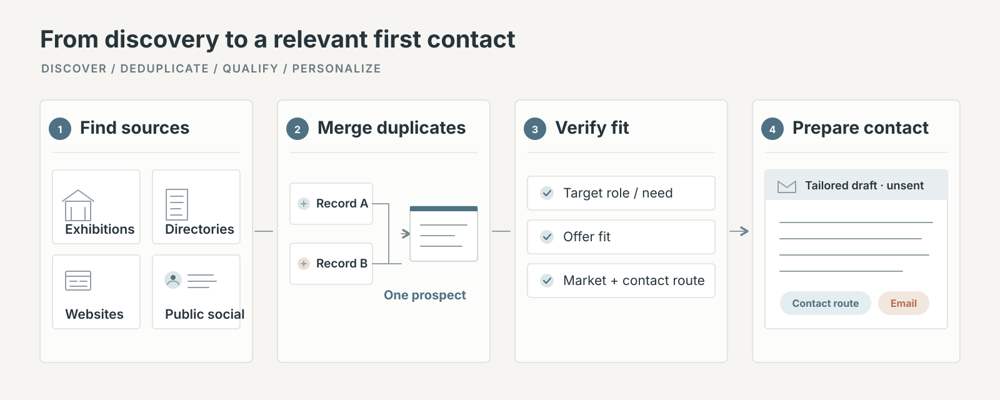

# Aliasearch

<p align="center">
  <strong>Find the right buyers. Know why they fit. Start the conversation well.</strong>
</p>

<p align="center">A portable customer-research skill for Claude, Codex, Cursor, and compatible agents.</p>

<p align="center">
  <a href="#quick-start">Quick start</a> ·
  <a href="#how-it-works">How it works</a> ·
  <a href="#what-you-get">What you get</a> ·
  <a href="#limits">Limits</a>
</p>

<p align="center">
  
</p>

Aliasearch helps B2B teams turn “find me customers” into a clear brief, focused research, evidence-based qualification, and useful individual outreach drafts. It works across products, services, and markets. **It prepares the work; it never sends messages.**

## Why use it?

A capable assistant can do prospect research from a prompt. Aliasearch packages the work into a repeatable path: preserve the user's request, ask for context that changes the answer, choose sources for the market, deduplicate before deep research, check buyer fit, recover when a tool fails, and tailor each draft to its evidence.

| Research | Qualification | Outreach |
| --- | --- | --- |
| Map the market and its best company sources | Check who the company is, what it buys, and why the offer fits | Prepare a relevant contact route and a distinct draft for each approved lead |

The skill makes the process repeatable; it does not make an agent inherently smarter or grant access to sources it cannot already reach.

### Aliasearch and other tools

Many prospecting tools start with a company database and build outreach around its records. Aliasearch is designed to investigate the sources that make sense for your specific market, then qualify each candidate against your brief.

| | Aliasearch | Other tools |
| --- | --- | --- |
| **Finding companies** | Maps relevant exhibitions, exhibitor lists, showcases, associations, registries, directories, marketplaces and company websites. Uses targeted web searches and search operators to uncover additional sources. | Many begin with a maintained company database; source coverage varies by product. |
| **Social research** | Can investigate relevant public profiles and posts across platforms available to your assistant, alongside other sources. | Social coverage and depth vary by product and data provider. |
| **Fit for your offer** | Checks the company, buyer role, market, offer or use case, and a public contact route against your criteria. Missing evidence stays visible. | Many offer filters and AI enrichment; qualification methods vary. |
| **Context for outreach** | Connects a relevant source-backed signal to your offer and prepares an individual draft for the chosen channel. | Many support personalization; source depth and channel support vary. |
| **Control and output** | Follows your requested count, locations, exclusions, channels and format. Keeps research evidence available and drafts ready for review. | Some provide large databases, integrated sending, reply handling and scheduling. |
| **Setup and cost** | Skill files run with a compatible assistant and its available tools; no Aliasearch subscription or API is required. | Pricing, included data and automation vary. |

**Where Aliasearch stands out:** flexible source discovery, research shaped around your exact offer, and transparent reasons for qualification. The Dubai textile research demonstrated why this approach can uncover relevant leads in sources outside a single database. It was not a controlled comparison, so it does not establish a universal coverage or conversion advantage.

Platform access depends on your assistant, available tools and permissions. Aliasearch cannot guarantee access to every social platform or a complete search of the web. Some other tools offer larger proprietary datasets and automate sending and replies; Aliasearch prepares research and drafts for your review.

## How it works

1. **Clarify the brief.** Carry forward the user's scope, count, market, exclusions, channels, and output. Ask about missing details that could change the result.
2. **Map and search sources.** Start with high-density sector sources such as fairs, associations, registries, directories, and marketplaces, then fill gaps with company websites and public social profiles.
3. **Audit candidates.** Normalize and deduplicate records; check company identity, market, buyer role, offer fit, and a public business contact route.
4. **Prepare the next action.** Return qualified leads with evidence links and a tailored draft for each approved contact. Keep uncertain and excluded records out of the priority list.

## What you get

A concise, usable contact view—usually company, location, contact route, why it fits, source link, and a channel-specific message. More detailed research stays in a separate ledger when the job needs it. The format can be a spreadsheet, a compact list, or another requested deliverable supported by the agent.

The requested count is the target. If no count is given, Aliasearch asks and may suggest 20. It returns fewer when fewer prospects pass the fit checks; it never pads a list to hit a number.

## Quick start

Choose the path that matches your agent.

### Claude web or desktop

1. Download [`dist/aliasearch-claude.zip`](dist/aliasearch-claude.zip).
2. In Claude, open **Settings → Customize → Skills** and upload the ZIP.
3. Enable **Aliasearch**, start a fresh chat, and describe the buyers you want to find.

If **Skills** is not available, custom Skills may not be enabled for your account or workspace.

### Claude Code, Codex, or Cursor

```sh
git clone https://github.com/akshatkotharii/aliasearch.git
cd aliasearch

./install.sh --agent codex   # or: claude, cursor, all
```

Restart the agent after installation. Use `/aliasearch` in Claude Code, or invoke the skill through the command your agent supports.

For local CSV deduplication, Python 3.10 or newer is needed; no Python packages are required. Run `python3 scripts/doctor.py` to check local commands. Web search and social access depend on your assistant and cannot be established by this script. The core skill can still be used without Python.

To process an existing candidate file locally:

```sh
python3 scripts/normalize_candidates.py candidates.csv --output normalized.csv --collisions review.csv
```

The helper suggests duplicate groups for review; it does not verify contacts or decide buyer fit. Your assistant can then review the shortlisted evidence and write drafts. Keep source files and results in your own workspace so later sessions can reuse them.

If your evidence ledger is JSON Lines with a `company_id` field, select complete records for a review without loading the entire ledger into the assistant:

```sh
python3 scripts/evidence_packet.py evidence.jsonl --company-id C001 --company-id C002 > packet.jsonl
```

The helper preserves selected records and reports missing IDs; it does not fetch or verify sources. Actual token savings depend on the assistant and must be measured.

For another compatible local agent, install into its skills folder:

```sh
./install.sh --path /your-agent/skills/aliasearch
./install.sh --list
```

## Give it a useful brief

Start with the facts that change who qualifies:

- **Offer:** what you sell and its main uses
- **Buyer:** the kind of customer, role, or purchasing channel
- **Market and count:** where to search and how many you want
- **Fit and exclusions:** useful buying signals, poor-fit cases, and names to omit
- **Output:** contact fields, evidence links, and whether you need email, call, or social drafts

You do not need to know the sector vocabulary or research sources. Add sender details, approved claims, preferred tone, and the reply you want when asking for outreach drafts.

### Prompt starter

```text
Use Aliasearch to find [count] [buyer type] in [market] for [offer].
A strong fit is [buying/use signals]. Exclude [names or categories].
Return [format] with the best public contact route, evidence links,
why each company fits, and an individual [email/message] draft.
```

## Limits

- There is no built-in contact cap. Coverage depends on source availability, the agent's tools and access, time, and its ability to save and resume larger jobs. A whole-internet search cannot be guaranteed; checked and unavailable sources should be reported accurately.
- Public social pages can enrich research. Logged-in pages are usable only when the agent already has authorized access; Aliasearch does not provide logins or bypass access controls.
- The skill does not send messages, guarantee replies, or promise inbox placement.
- No Aliasearch API or paid package is required. Web search comes from the agent or platform being used and may have its own access limits or costs.
- Python 3 is optional for the local deduplication helper.

## In the repository

| Path | Purpose |
| --- | --- |
| [`SKILL.md`](SKILL.md) | Main workflow and agent instructions |
| [`references/`](references/) | Intake, research, recovery, and outreach guidance |
| [`scripts/normalize_candidates.py`](scripts/normalize_candidates.py) | Optional local deduplication helper |
| [`assets/aliasearch-workflow.svg`](assets/aliasearch-workflow.svg) | README workflow illustration |
| [`dist/aliasearch-claude.zip`](dist/aliasearch-claude.zip) | Upload package for Claude web and desktop |
