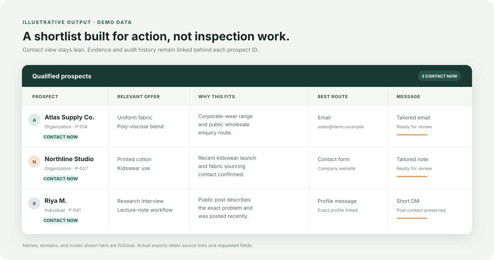

# Aliasearch

<p align="center">
  <strong>Turn an offer into a sourced shortlist of people worth contacting.</strong>
</p>

<p align="center">
  Aliasearch gives compatible AI assistants a repeatable prospect-research workflow: understand the brief, search the right source families, verify fit, remove duplicates, preserve evidence, and prepare tailored outreach when requested.
</p>

<p align="center">
  <a href="#install">Install</a> ·
  <a href="#use-aliasearch">Use it</a> ·
  <a href="#what-you-get">See the output</a> ·
  <a href="#when-something-breaks">Recovery</a>
</p>

<p align="center">
  
</p>

## Why use it?

A normal prospecting prompt can produce names quickly. It often loses the original targeting rules, repeats the same companies, treats a directory listing as proof of fit, or drafts outreach before confirming a usable route.

Aliasearch keeps the research disciplined:

- **Full context first:** preserves offer, audience, geography, exclusions, count, channels, proof claims, and output requirements.
- **Broader discovery:** maps fairs, associations, registries, procurement portals, marketplaces, company sites, web results, and accessible social profiles.
- **Evidence before outreach:** separates discovery sources from proof of fit and links each decision to public evidence.
- **Useful contact routes:** records where contact can happen instead of returning a list of names alone.
- **No padded lists:** deduplicates candidates and reports honest shortfalls when fewer prospects pass.
- **Lean delivery:** shows only fields needed to review, contact, or call a prospect; detailed evidence stays in the research ledger.

It works for B2B organizations and individual-user research across sectors. It does not depend on a proprietary lead database or paid Aliasearch API.

## What you get

<p align="center">
  
</p>

Default output stays compact:

| Field | Purpose |
| --- | --- |
| Prospect | Company, organization, or individual account |
| Best route | Public email, phone, profile, contact page, or other requested channel |
| Relevant offer | Product or use case that matches the prospect |
| Why this prospect | One evidence-backed reason to contact them |
| Tailored message | Included only when outreach drafting is requested |
| Source | Link or source ID supporting fit and route |

Detailed evidence, alternate routes, rejected candidates, missing gates, and duplicate decisions remain in the ledger instead of bloating the contact sheet.

## How it works

1. **Brief** — reads the full request, carries forward supplied facts, and asks only questions that can change targeting or output.
2. **Discover** — starts with high-density sector sources, then fills gaps through targeted web, company, marketplace, and accessible social research.
3. **Verify** — checks identity, geography, buyer or user signal, offer fit, recency where relevant, and a sourced contact route.
4. **Deliver** — deduplicates, ranks by decision, keeps evidence traceable, and drafts channel-specific outreach when requested.

The requested prospect count remains the target. If no count is given, Aliasearch asks and suggests 20. It never silently turns a full search into a sample.

## Install

### Local agents: Codex, Claude Code, or Cursor

Requirements: `git` and a compatible agent that can load `SKILL.md`. Python 3.10+ is optional and only powers local normalization and evidence helpers.

```sh
git clone https://github.com/akshatkotharii/aliasearch.git
cd aliasearch
./install.sh --agent codex
```

Replace `codex` with `claude`, `cursor`, or `all`. For another Agent Skills-compatible host:

```sh
./install.sh --path /your/agent/skills/aliasearch
```

Verify copied files before restarting the agent:

```sh
./install.sh --verify --agent codex
```

Start a new chat after installation. Invoke `$aliasearch` or `/aliasearch` when the host supports explicit skill commands; otherwise ask the assistant to use the Aliasearch skill.

### Claude web or desktop

1. Download [`aliasearch-claude.zip`](dist/aliasearch-claude.zip).
2. Open Claude's skill/customization settings and upload the ZIP.
3. Enable Aliasearch, then start a new chat.

Availability and labels can differ by Claude plan or workspace. The ZIP contains the same `SKILL.md`, references, version, and Python helpers as the local package.

### What installation includes

- Aliasearch instructions and qualification gates
- intake, research, outreach, and recovery references
- local Python helpers for normalization and compact evidence packets
- version and update checker

Installation does not add web search, browser login, social-platform access, or paid data sources. Aliasearch uses capabilities already available and authorized in the host. During a run, it checks those capabilities and reports any coverage it could not verify.

## Use Aliasearch

Give it the business context you already know. It will ask for missing facts only when they affect the result.

```text
Use $aliasearch to find 40 wholesale buyers in Indonesia for cotton shirting fabric.
Exclude the customers in my attached list. Prioritize public business email routes.
Return a lean spreadsheet and draft an individual email for every qualified buyer.
```

```text
Use $aliasearch to find 30 students who publicly describe difficulty taking notes
from lecture videos. Search India and other markets. Link each profile to the exact
post supporting the use case and draft a short feedback message.
```

Good inputs include:

- what you sell or want people to adopt;
- ideal buyer, user, or organization;
- geography and target count;
- must-have fit signals and exclusions;
- preferred contact channels;
- sender facts and claims allowed in outreach;
- desired output format.

## When something breaks

Aliasearch repairs the selected route before hiding the failure behind a fallback. It classifies the error, inspects the smallest failing case, applies a narrow fix, verifies the original capability with a read-only action, then resumes from saved work.

For installation problems:

```sh
./install.sh --list
./install.sh --verify --agent codex
python3 scripts/doctor.py
```

The recovery rules distinguish four separate states: package files copied, package files verified, host recognized the skill, and required search or browser capability available. Success in one state is never reported as proof of the next. Login, permission, paid actions, anti-bot challenges, and destructive fixes still require user action or authorization.

See [recovery rules](references/recovery.md) for the bounded repair loop and stopping conditions.

## Update

Local installation:

```sh
git pull --ff-only
./install.sh --agent codex
./install.sh --verify --agent codex
```

Use your selected agent name or custom path. Restart the agent after updating. Claude web or desktop users should download and upload the latest ZIP again.

Aliasearch may check GitHub once per session and mention a newer version. It never installs updates automatically.

## Optional local helpers

```sh
python3 scripts/doctor.py
python3 scripts/normalize_candidates.py candidates.csv --output normalized.csv --collisions review.csv
python3 scripts/evidence_packet.py evidence.jsonl --prospect-id P001 > packet.jsonl
```

These helpers use Python's standard library. The normalizer proposes organization duplicate groups for human review. The evidence helper selects existing complete records; it does not scrape, summarize, qualify, or validate them. Core research can run without Python.

## Limits

Coverage depends on search, page, browser, and authorized account access available to the assistant. No workflow can guarantee complete internet coverage, a requested number of qualified prospects, replies, conversion, or inbox placement. Aliasearch reports what was checked, what passed, and what remained inaccessible.

## Project status

Aliasearch is an independent open-source workflow. Results from earlier textile and software-user research informed its design, but they are not controlled benchmarks. Product and conversion advantages over other tools remain unproven until measured on comparable briefs and source access.
